# NIOPowerSwapAssist

一个**社区版**的蔚来全生态客户端 + 多租户 Rust 后端项目，覆盖 **iOS App / 灵动岛与实时活动 / 桌面与锁屏小组件 / 控制中心与 Siri 捷径 / Apple Watch 独立端 / Apple TV 客厅展厅 / MCP Agent 服务**。

---

## 为什么要做这个项目

首先，`蔚来 App` 的审美和交互逻辑烂透了！*It Sucks!* 有以下罪状：

1. 打开 App 那个 logo 非得转一圈，开个 App 要 5s 以上
2. iOS 版本 App 有些页面能右滑返回，而有些不能
3. 我真的用不到首页的社群社区这些功能
4. 这套 VI 已经用了 5 年了，远跟不上时代了
5. Bug 一堆，很多描述不清楚，提给官方，不改
6. 操作逻辑奇怪，loading 有时候不能成功 disable，导致整个 App 卡死，只能杀掉重新进

---

## iOS 端界面一览

<table>
  <tr>
    <td width="33%" align="center">
      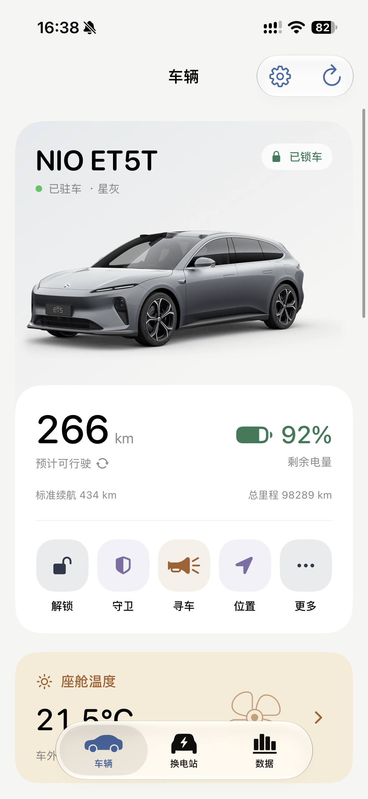
    </td>
    <td width="33%" align="center">
      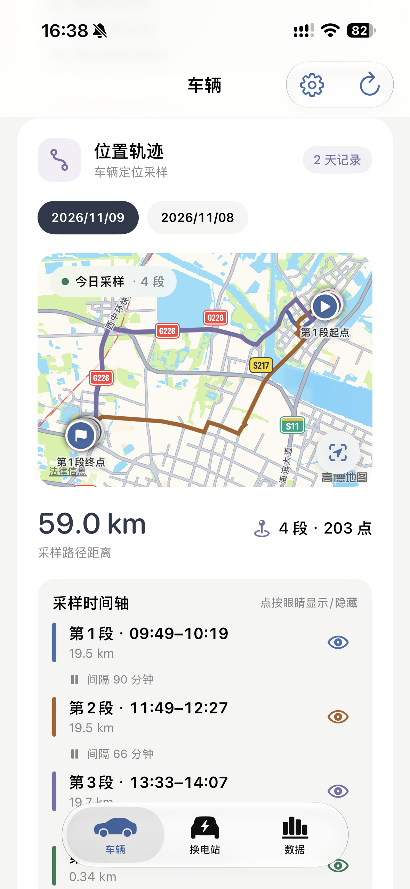
    </td>
    <td width="33%" align="center">
      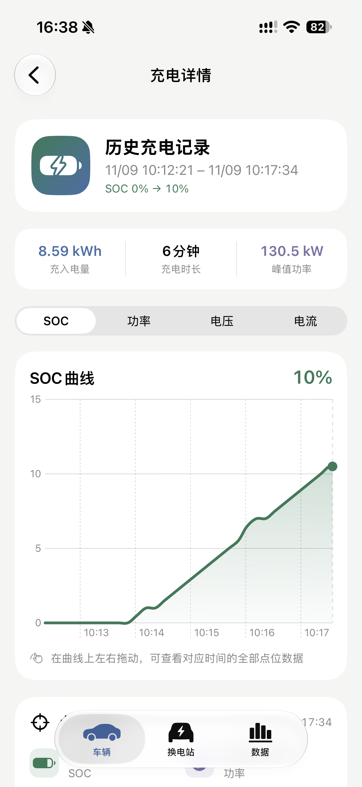
    </td>
  </tr>
  <tr>
    <td align="center">
      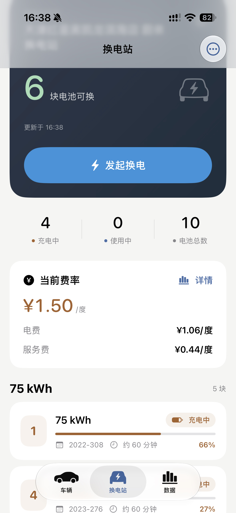
    </td>
    <td align="center">
      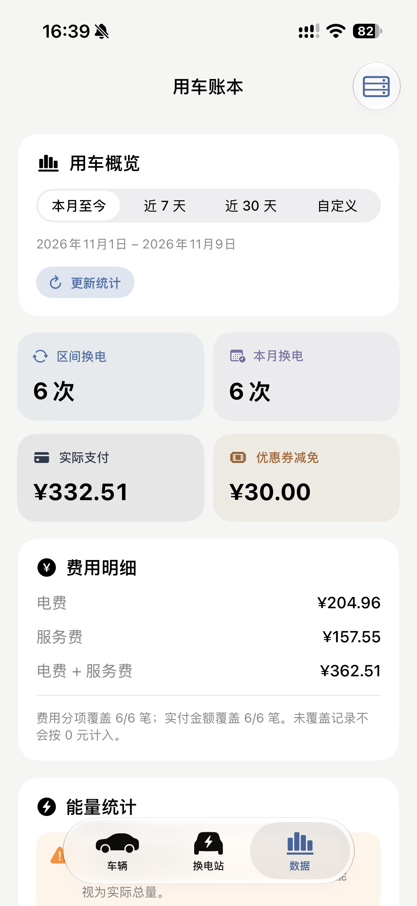
    </td>
    <td align="center">
      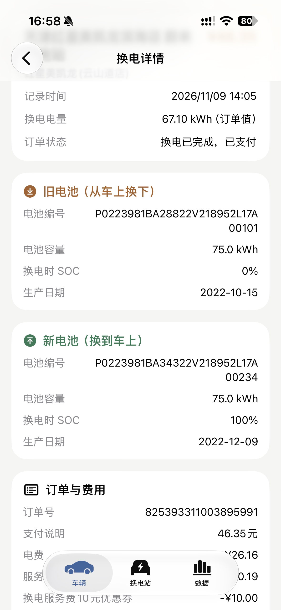
    </td>
  </tr>
</table>

---

## 核心功能矩阵

### iPhone 端与系统级集成
- **车辆状态与远程控制**
  - 实时车况（SSE 推送 + 轮询兜底）、表显 / 实估续航切换、舱内外温度与门锁状态
  - 特殊状态提醒（维修中、FOTA 系统升级、换电中、防盗追踪 SVT），点击状态标签弹窗查看详情
  - 常用远控：锁车、解锁、解锁启动、守卫模式、空调温控、寻车等（全部单次确认执行，不自动重试）
- **路径规划与一键发车机**
  - 支持途经点排序、加电补能规划开关与常用路线收藏，一键发送到车机导航
- **行程数据与 GPS 轨迹**
  - 行程起终点、里程、均速、耗电与百公里能耗
  - 通过后端持续采样车辆位置，在地图上还原高准确度行驶轨迹
- **换电记录与周期补能统计**
  - 精确到换上 / 换下电池包信息、电费/服务费拆分、优惠券抵扣与实付金额
  - 30 天换电/充电电量占比与费用总览
- **换电站实时监控**
  - 站内每个仓位的电池电量、型号（70/75/100/102 kWh）、充电剩余时间与生产日期序列号
  - 全天分时计费标准与附近换电站快速切换
- **充电数据**
  - 可回看的实时功率、电压、电流曲线，通过功率积分准确估算充入电量
- **系统原生拓展**
  - 桌面小组件、锁屏组件、iOS 控制中心车控开关与 Siri 语音捷径（查站内电池/远程车控）

### 实时活动与灵动岛

支持 iOS Live Activities 与 Dynamic Island，不用打开 App 也能实时盯住充电进度和换电排队状态：

- **充电实时活动**：SOC、续航里程、充电功率、累计充电量及目标 SOC
- **换电排队实时活动**：换电站名称、排队位置、换电号及预计等待时间
- **灵动岛**：充电和换电分别以紧凑视图显示关键状态

> 下图为根据实际界面截图绘制的组合展示示意图。

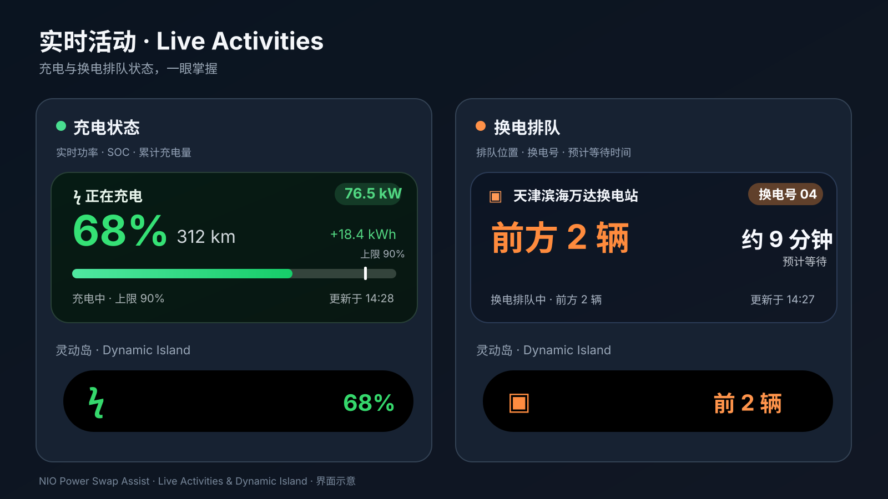

---

## Apple Watch 独立伴侣端

支持从 iPhone 同步配置后**独立联网直连后端**，同时提供表盘复杂功能：

- **腕上车况总览**：电量环、预计续航、舱内温度、锁车状态，以及维修 / 升级 / 换电等特殊状态醒目提示
- **抬腕远程车控**：空调温度步进 + 锁车 / 解锁启动 / 空调 / 寻车，支持**轻点确认、长按图标直发**
- **腕上换电站**：实时查看附近/常用站点的可用电池数、当前电价与排队状态，支持一键发起换电

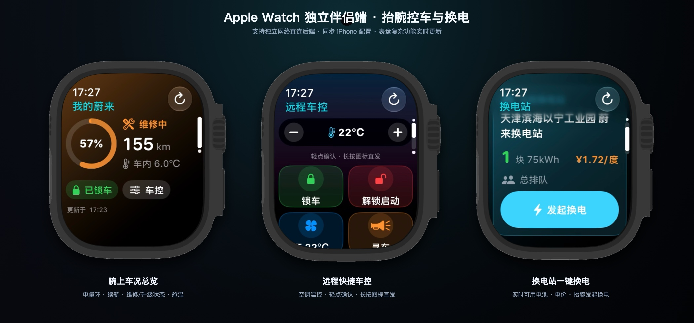

---

## Apple TV 客厅展厅端（`NIOPowerSwapAssistTV`）

面向 tvOS 18 打造的原生 10-Foot 客厅大屏伴侣应用，与 iOS 共享底层网络、SSE 实时事件流与数据模型：

- **2×2 客厅展厅总览**：官方车型渲染展台 + 聚合遥测面板 + 底部出门前快捷车控（空调温控、开/关空调、守卫、锁车、寻车；**严格排除解锁启动**）与常用路线一键发车机
- **展厅屏保模式（Ambient Mode）**：纯净暗黑影院底布 + 状态呼吸氛围光 + 超大极细时钟 + 底部遥测坞，内置防休眠与 **OLED 防烧屏像素微移**
- **换电站实时监控墙**：4 列电池仓位矩阵、充电进度倒计时、可换电池统计及遥控器横向浏览全天分时电价
- **30 天补能与充电功率曲线**：大屏 Charts 实时/历史充电曲线与近期充电记录切换
- **行程与 GPS 轨迹**：左右分屏行程列表 + MapKit 轨迹路线与里程/均速/能耗 HUD
- **iPhone 局域网零输入配对**：通过 Bonjour（`_niopowerswap-tv._tcp`）自动发现或系统相机扫描电视二维码 + 6 位动态配对码（5 分钟有效、恒定时间校验），免遥控器输入地址与密钥（车控 Key 默认关闭，需显式开启）

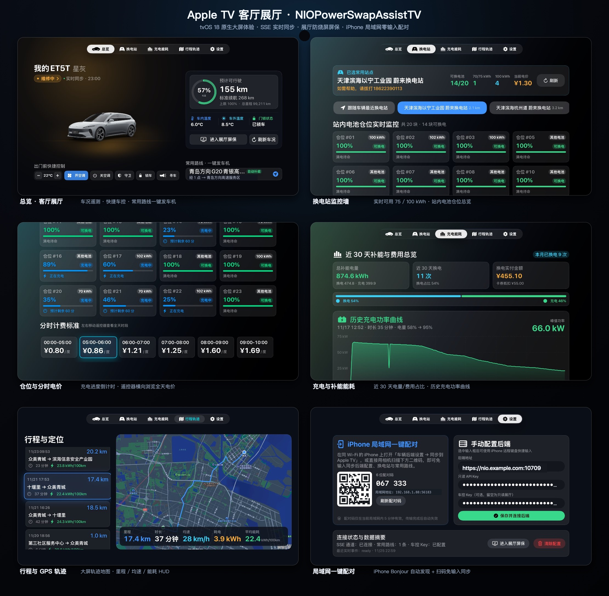

---

## 后端提供了什么能力

几乎所有的核心采集、缓存与分析逻辑都在 Rust 后端完成，除服务多端 App 外还提供：

1. **MCP Server（默认支持 OpenAI 授权）**：暴露完整工具集交给 Agent，可以做到：
   - 主动提醒该换电了、附近哪里有可用电池、电池生产日期是什么时候、距离多远、换电预计费用是多少、去哪个站最合适
   - 自动复盘并总结行车风格与能耗表现
   - *TODO*：训练一个轻量的 `14 - 64 - 32 - 1` 神经网络，引入行程信息 + 天气 + 轮胎滚阻 + 个人驾车习惯 + 海拔变化来预测整体行程能耗，比官方 App 仅靠平均能耗估算准得多（*Much Better!!!*）
2. **自动签到**：支持每日随机时间自动完成签到
3. **多租户架构**：单个后端实例可同时隔离并服务多辆车，支持 SSE 实时事件推送

<table>
  <tr>
    <td width="33%" align="center">
      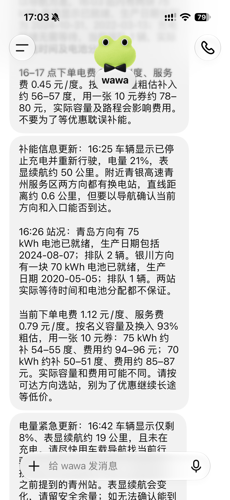
    </td>
    <td width="33%" align="center">
      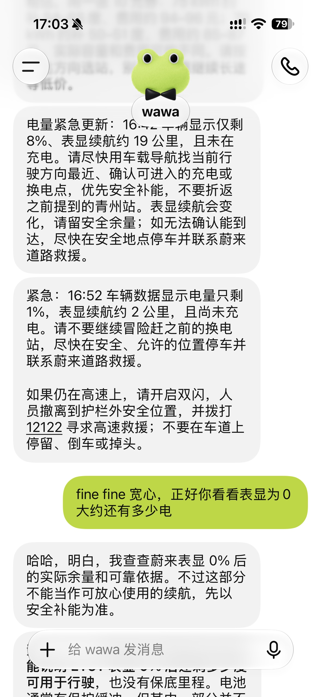
    </td>
    <td width="33%" align="center">
      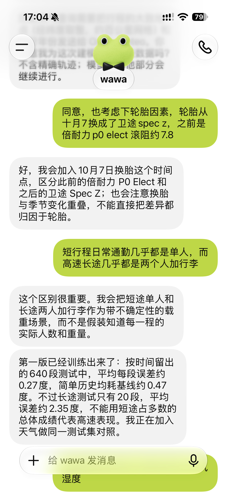
    </td>
  </tr>
</table>

---

## 路线图与待完善项

- [x] iOS App + 桌面/锁屏小组件 + 灵动岛实时活动 + 控制中心 & Siri 捷径
- [x] Apple Watch 独立端 + 表盘复杂功能
- [x] Apple TV 客厅展厅版（含展厅屏保与 iPhone 局域网一键配对，为后续 HomeView 铺路）
- [ ] App 蓝牙数字钥匙与近场车控协议
- [ ] Android 客户端版本
