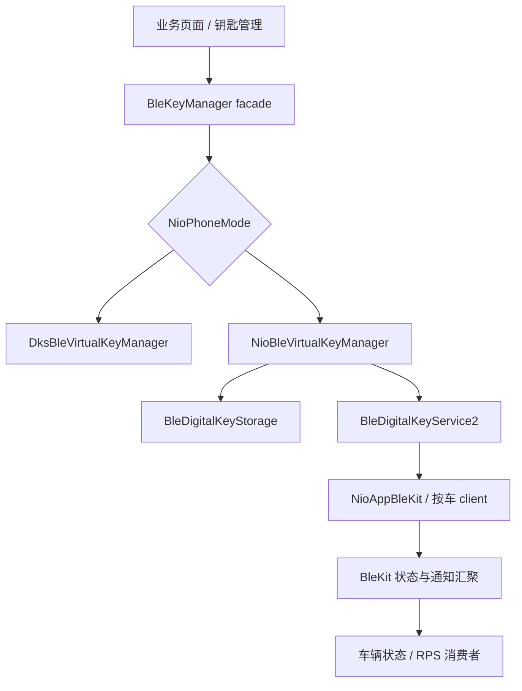

# Android BLE 数字钥匙：生命周期、状态流与认证边界详解

日期：2026-11-25。接续 [本轮证据说明](android-ble-uwb-followup-2026-11-25.md)。本篇分析的是原版 Android 业务层如何管理已有合法钥匙与连接服务，不是可直接发送车辆命令的协议实现。

## 1. 证据级别与阅读方式

本篇证据均来自既有 DEX 的离线 JADX 输出，没有启动设备、读取账号材料或发送请求。源码根目录记为 `R=/private/tmp/nio-analysis-radio-src/sources`。主要文件均在 `R/com/nio/rb/virtual/key/` 下；下文路径相对于这个目录，行号对应本次输出，不是原始 Kotlin 行号。

这批反编译有大量错误，部分方法包含未初始化变量、不完整协程分支和 `JADX ERROR`。因此：

- **已确认**表示可以直接从已检查的方法体、类型和调用关系读到。
- **推断**表示基于这些事实提出的架构解释。
- **未确认**不会用类名、字段名或日志文本补成协议事实。

本轮后续从同一转储恢复了 engine DEX：offset `93024256`、size `2677952`，文件 `/private/tmp/nio-analysis-engine.dex`，SHA-256 `b1d3aa08afdfa0caf89722e9846c9c8d9bc2ed64dec281544ac60c4419a7eda3`。JADX 输出 `/private/tmp/nio-analysis-engine-src/sources`，退出码 3、报告 227 个错误。因此现在能读取 `NioAppBleKit`、`NioAppBleClient`、`BleDigitalKeyStorage`、`BleDetailedKeyInfo` 的更多方法体，但仍不是无缺失的完整源码。第 13 节单独列出这批补充证据。`BleKit.h()` 本身反编译失败，不能用其他方法补成原方法的完整控制流。

## 2. 层次关系：至少两套 BLE 后端

`manager/BleKeyManager.java:101` 的 `A()` 按 `NioPhoneMode.a.c()` 选择 `B()` 或 `C()`；二者分别是惰性创建的 Dks manager 和 Nio manager。多数 facade 方法转发给当前 manager，不能把 Nio 分支代表为所有手机的实现。

`BleKit.java:580` 附近静态初始化同时挂接 NioPhone 与 NioApp 两套回调：通知、按车辆的布尔状态 map、激活响应等。NioPhone 支持条件还取决于 adapter 返回值。本篇未解读 Dks SDK 内部协议。

## 3. 四种状态不能混为一个“蓝牙已连接”

| 状态维度 | 已见源码表达 | 能说明什么 | 不能说明什么 |
| --- | --- | --- | --- |
| 本地钥匙记录 | `BleDetailedKeyInfo`、`BleKeyStatus` | 是否已有记录、是否启用 | 不代表当前在车辆附近 |
| 本地开关/绑定 | `switchOn()`、`getBound()` | 钥匙开关与 bound 标记 | bound 不能直接等同操作系统 BLE bonding |
| 服务认证状态 | `Map<vehicleId, Boolean>` → AUTHED/IDLE | service 如何呈现当前车辆的状态 | 不暴露认证握手步骤，也不是完整 GATT 状态机 |
| 业务会话 | 通知与 RPS 消费者 | 当前业务收到哪些事件 | 不代表已具备移动权限或车辆端确认 |

证据：`nio/ble/NioBleVirtualKeyManager.java:1289` 的 `g()` 更新钥匙状态；`:1329` 的 `j()` 读取 switchOn；`:1352` 的 `k()` 在缺省时回到 UNCREATED；`:1385` 的 `p()` 更新 bound；`:1767` 的 `h()` 检查 bound。

`g()` 特别值得保留：Android 12+ 会检查 SCAN、CONNECT、ADVERTISE 权限。请求将状态设为 ACTIVATED 但权限不满足时，实际存为 SWITCH_OFF；满足时才存 ACTIVATED 并进入 companion-device 关联流程。方法名中虽有 IgnorePermission，实际方法体仍有权限相关分支，不能按名字理解成绕过检查。

## 4. 初始化与服务启动的完整上层链路

`nio/ble/NioBleVirtualKeyManager.java:1244` 的 `f()` 是 initBle 入口：

1. 设置 `callForegroundOnce=true`。
2. 从 preferences 读取 `auto_connect_mode`，默认 true，传入 LgBle。
3. 把连接状态 listener 注册到 vehicle system service。
4. 安装 `BleDigitalKeyService2.notificationCallback`。
5. 安装 BLE APM action/reason 回调。
6. 触发 `BleKit.c()`；该方法当前输出只记录 initKit 日志，关键订阅实际在静态初始化中，不能把它当成全部初始化过程。

后台启动 `r()`（`:1085`）先检查系统是否忽略本 App 的电池优化；通过才调用 `u()`。前台恢复直接进入 `u()`。

`u()`（`:1100`）顺序为：当前车辆 → 本地钥匙开关 → BLE 权限检查 → service 启动。权限不匹配时只记录失败并返回。service companion 根据 `callForegroundOnce` 与 `hadCallStartForeground` 选择不同启动路径。由于实际 Runnable 的具体系统 API 不在本篇复核范围，不能仅凭日志声称每次都调用 `startForegroundService()`。

## 5. Service 内部：观察认证状态并定期检查扫描

`service/BleDigitalKeyService2.java:380` 的 `onCreate()`：

1. 调用父类；读取远端配置 `ble_service_crash_fix`。
2. 设置 running 标记，清空上次通知状态。
3. 从 storage 取当前车辆，并查询该车 service 的布尔状态。
4. 首次强制发出 AUTHED 或 IDLE 通知。
5. 注册钥匙 flow；在 lifecycleScope 启动扫描检查协程。

`registerKeyFlow()`（`:266`）订阅的是 `BleKit.b` 的整车状态 map。每次 map 发出时，重新从 storage 读取当前车辆 ID，选择该车辆的值，再交给通知处理。这里不是固定订阅初始化时的车辆 ID。

`registerKeyFlow$2`（`:144`）把 true 映射为 AUTHED，其余映射为 IDLE。在只允许前台、App 已不在前台、当前未认证的组合条件下停止自身。

`startScanJob$1`（`:206`）能读到首次延迟 1 秒、随后每轮调用 `NioAppBleKit` 并等待 15 秒的结构。**15 秒是扫描检查任务的调度间隔，不是 BLE 扫描窗口、连接间隔、广播间隔或业务心跳周期。** 协程恢复分支和首次执行分支存在明显失真，尤其 `onlyForeground` 相关条件不能直接作为完整停止规则照搬；应以字节码复核后再定精确真值表。

`notifyService()`（`:425`）会去重相同 status，forceRefresh 可绕过去重；callback 尚未安装时安排 1 秒后的延迟任务。延迟任务本体本篇未复核，不能声称无限重试或明确的最大重试次数。

`onDestroy()`（`:408`）重置 running/status/部分 foreground 标记并调用父类。它本身没有展示所有 BLE client 的销毁，不能把 service 消失等同全部连接资源均已释放。

## 6. 前后台、钥匙变化与手机模式变化

Nio manager 构造器（`nio/ble/NioBleVirtualKeyManager.java:1467`）安装三类长期订阅：

| 事件源 | 处理 | 证据 |
| --- | --- | --- |
| storage 中全部钥匙记录变化 | 先过滤 switchOn；若当前车辆仍在集合中，尝试后台启动；否则停止数字钥匙和 wake service | `:184`、`:1550` 附近 |
| NioPhoneMode 变化 | 为 true 时停止 Nio App 的两个服务，避免两套实现同时管理 | `:250` 附近 |
| App ON_RESUME | 设置 enterForeground，更新进程前台时间/统计上下文，调用启动入口 | `:313` 附近 |
| App ON_STOP | 清除 enterForeground、更新统计；在前台限定条件下停止 service | `:348` 附近 |

订阅在 GlobalScope 发起，并切到主 dispatcher 处理；service 自身扫描任务在 lifecycleScope。二者寿命不同：只销毁 service 不等于 manager 的订阅消失。这是 Android 原版的架构事实，不是建议在 iOS 复制全局 scope。

## 7. nearTheVehicle：当前找到的是显式提示入口

`nio/ble/NioBleVirtualKeyManager.java:1030` 的 `l()` 日志为 setNearTheVehicle：

- 向 LgBle 写入 `nearTheVehicle=true`；
- 获取当前车辆的 NioAppBleClient；
- 发起 tryRestartScan，原因文本为 Approaching car；
- 若 client 正处于 activating、钥匙不存在/开关关闭，或者已有异常重启 job 在运行，则不再创建重启 job。

**这段方法不是测距算法。** 它没有接收米数、角度或 UWB ranging result，而是上层主动发出的近车提示。若要判断提示由地理围栏、用户点击、RSSI 或 UWB 触发，必须继续查 `BleKeyManager.l()`/该接口的调用者；本次不把提示来源写成 UWB。统计调用中出现的 0.0f 也不能当成实际距离为零。

## 8. 认证材料：已确认依赖关系，尚未恢复握手

创建入口 `nio/ble/NioBleVirtualKeyManager.java:646` 接收 context、vehicleId、rawPin、证书模式、平台及异步回调。方法体先检查 DkCertMode、设备证书、私钥引用以及证书序列号；缺一项即提前返回。随后串联车辆 BLE calibration 查询、PIN 公钥信息及 owner/user 两条创建逻辑，将服务端 VirtualKeyData 转为 BleDetailedKeyInfo。

`createVirtualKeyByOwner` 与 `createVirtualKeyByUser` 在嵌套函数名及 API 调用中明确存在。但外层布尔参数已被混淆，尚未核对所有调用方，不将它固化为一个对外 API 的 owner 布尔协议。

`NioBleVirtualKeyManager$registerBleCertCallback$1.java:25` 和 `:47` 分别按 DkCertMode 获取证书与对应私钥材料。storage 实例以当前 App userId 选择；传入的 vehicleId 在这两个方法中被校验/记录，但没有作为 storage 查询键。因此，**设备证书与车辆钥匙记录是不同层级**，不能把一张证书等同任意车辆的授权。

本篇只记录调用关系，没有读取材料内容。尚未确认硬件保护级别、私钥是否可导出、证书轮换、吊销传播时延、车辆端 challenge/response、重放防护及会话密钥派生。也没有证据表明项目已有 HTTPS mTLS 证书可替代 BLE 数字钥匙材料。

异步创建链成功时报告成功并调用 success callback；失败时报告 Throwable 并传给 failure callback；订阅/结束阶段有 loading 回调。需注意前置材料缺失时返回 null，未见同一路径调用 failure callback，调用方应区分“根本未启动任务”和“异步任务失败”。

## 9. 通知路由与跨车辆隔离

`BleKit.java:615` 的 `onKeyStateChange` 收到 map 后复制成 LinkedHashMap，再更新 StateFlow。其前面的统计逻辑不能当成认证协议。

`BleKit.java:701` 的 `onNotifyData`：

1. 取当前车辆 ID。
2. 若消息携带的车辆 ID 不匹配则立即丢弃。
3. 按车辆配置读取 BLE protocol。
4. RPS notification 转给 BLE notification utility；车辆数据通知则经 `BleResponseConvertFactory` 转为 SummarizedStatus，写入车辆状态服务。
5. 再启动后续通知发布协程供消费者订阅。

这里已确认“进入业务层前先按车辆筛选”这一边界。原始通知的数据帧、字段单位和校验位置尚在下层，不应把 SummarizedStatus 模型当成无线报文布局。

`BleKit$registerVehicleChange$1.java:45` 附近在切车时清空激活响应、失败计数/时间以及失败弹窗状态。这一层只展示 UI/激活上下文重置，不能推出旧 GATT 连接必然立刻断开。

## 10. 清理、注销和删除的不同含义

| 操作 | 已见处理 | 尚不能声称 |
| --- | --- | --- |
| `NioBleVirtualKeyManager.clearAll()` | 开关流发 false、清本地 storage、停 service、清 companion 关联及手机模式等 | 服务端已吊销所有钥匙 |
| `deleteLocalKeyByVehicle` 对应 `y(vehicleId)` | 本地 Internal 清理、关闭授权相关状态、清该车 companion 关联 | 车辆端立即忘记钥匙 |
| BleKit 登录状态订阅的退出分支 | 对 NioPhone SDK 发 logout；遍历 NioApp clients 做清理、清两个缓存 map、注销 screen/Bluetooth receiver | 每个底层连接关闭结果已确认 |

证据分别为 `nio/ble/NioBleVirtualKeyManager.java:612`、`:1430`、`BleKit.java:500` 附近。底层 client 清理方法的新增证据见第 13 节；实际系统资源关闭结果仍需运行时验证。

## 11. 对本项目 iOS 的具体启示（设计建议，非原版事实）

- 独立建模 LocalKeyState、TransportState、AuthenticatedState、VehicleSessionState，避免“有钥匙”就显示“已连接”。
- 每份状态和事件都携带 accountId/vehicleId/session generation；切账号/切车后拒收旧回调。
- 自动连接默认值、后台保持、权限变化是策略输入；不要用一个全局 Boolean 同时驱动扫描与控制能力。
- 认证材料通过专门 provider 使用，界面/日志不接触材料本身；云端 token、HTTPS mTLS 与 BLE 钥匙材料分开管理。
- 扫描检查间隔、无线连接参数、业务安全超时分别命名，禁止互相替代。
- 清除本地钥匙、停止扫描、断开连接、撤销服务端授权分别返回结果，不能一个“删除成功”掩盖多个不同动作。

建议先用模拟 transport 验证以下场景：已建钥匙但无权限、权限恢复、前后台切换、当前车辆钥匙被关闭、手机模式切换、切车后旧消息到达、重复连接通知、认证失败、退出账号、创建前置材料缺失。它们可在不操作实车的情况下验证上层正确性；GATT/认证/车辆业务仍需完整契约后单独实现。

## 12. 下一步证据清单

| 问题 | 当前状态 | 下一条证据 |
| --- | --- | --- |
| app 后台为何停止/继续扫描 | 部分回答 | startScanJob 协程原始字节码、LgBle.getOnlyForeground |
| 近车提示从哪里产生 | 找到写入入口，来源未明 | BleKeyManager.l() 的所有调用方 |
| 认证完成的 Boolean 如何产生 | 发布/汇聚/消费已确认，见第 13 节 | handler 的合法认证阶段契约与实测 |
| client 工厂和按车复用 | engine 工厂与单车连接条件已确认 | 修复 BleKit.h() 反编译以核对另一入口 |
| 扫描、GATT 连接与重连 | client 协调与恢复已确认，stack 未完整恢复 | stack 层方法体及受控只读观测 |
| 证书更新/吊销 | 创建依赖已确认 | certificate provider 生命周期与错误路径 |
| UWB 与这套 BLE 的关系 | 不可从近车标记证明 | OEM key SDK 与测距消费者之间的实际调用边 |

上述清单记录业务层调查的边界，其中 engine client 与 Boolean 发布点已在随后恢复，详见下一节；尚未回答的下层问题仍保留。

## 13. Engine DEX 补充：连接、认证完成和销毁已能区分

本节路径相对于 `/private/tmp/nio-analysis-engine-src/sources/com/nio/lego`。

### 13.1 存储记录不是连接对象

`com/digitalkey/ble/data/BleDetailedKeyInfo.java:35` 构造新记录时保存 vehicleId、BleKeyInfo、创建时间和 VIN，初始状态为 CREATED；`switchOn()`（`:96`）只在状态为 ACTIVATED 时返回 true。记录还分别持有 mac、bound。

`BleDigitalKeyStorage.java:137` 缓存当前车辆；`:152` 保存全部记录并异步发出变化；`:170` 明确声明退出登录应清理；`:250` 更新单车 MAC；`:265` 把开关映射为 ACTIVATED/SWITCH_OFF。惰性载入、删除与插入的方法存在空块等反编译失真，不据此声称持久化全流程已恢复。

storage 使用的底层 SSP 实现本篇没有审计。不能根据类名把它称为硬件安全存储，也不能从 schema 存在推断钥匙材料可安全迁移到 iOS。

### 13.2 按车 client 池与单活动车辆策略

`digitalkey/engine/NioAppBleKit.java:150` 保存 `ConcurrentHashMap<vehicleId,NioAppBleClient>`，`:153` 保存每车 StateFlow；`:258` 的 flow 工厂首次返回 false。

`refreshService` 即 `e(keyList)`（`:272`）执行以下协调：注册屏幕和蓝牙开关 receiver；清理已销毁 client；对 ACTIVATED 的记录创建/复用 client 并调用 scanOrConnect；对其他状态，在 client 不处于 activating 时移除并销毁；最后清理已经不在 keyList 的 client。

**多车缓存不意味着多车同时自动连接。** `NioAppBleClient.D()`（`:365`）会把 storage 当前车辆与自身 vehicleId 比较，不一致就以 single mode 返回。这是明确的方法体证据。

### 13.3 scanOrConnect 的前置条件和缓存 MAC 路径

`digitalkey/engine/client/NioAppBleClient.java:365`：

1. 已 destroyed 则返回。
2. 仅前台模式、尚未认证且 App 不在前台时返回。
3. 非当前车辆返回。
4. 无钥匙或开关关闭返回。
5. 当前连接 Boolean 已 true 时返回。
6. 读取缓存 MAC，并综合 autoConnect、证书分支标志、地址格式、系统 bondedDevices 判断能否走缓存设备连接。
7. 缓存设备不适用时走扫描；某些失效缓存条件会清掉 MAC。
8. stack 扫描入口再次检查权限，并避免重复扫描/重复连接同一目标。

这里看到的系统 bondedDevices 是 OS 层配对信息，与第 3 节记录中的 bound 字段应分开理解。代码把 `!nearTheVehicle` 传给后续连接方法，但参数的底层 Android 连接语义未在本节展开，不给它擅自起名为“远距离模式”。

### 13.4 连接成功 ≠ 通知就绪 ≠ 认证完成

| 层级事件 | 原版响应与行为 | Boolean 状态 |
| --- | --- | --- |
| onConnectStart | 发出 connect start；已经认证则不重复 | 不设 true |
| onConnectSuccess | 发出 connect success；启动 blocking/non-blocking 两种命令消费任务；进入通知订阅 | 不设 true |
| onNotifySuccess | 发出 notify success；取消部分等待任务并安排下一阶段超时处理 | 不设 true |
| handler 对应认证阶段写入完成 | 调用 handler 完成处理、重置重试计数、发出 auth success | 设 true |
| onDisConnected | 取消消费任务、清理 handler 与挂起 callback、发出 disconnect | 设 false |

证据：`NioAppBleClient.java:561`、`:936`、`:509`、`:1105`、`:734`。认证完成由内部 handler 的关联消息条件控制；本篇没有解析该消息内容或推导无线认证帧。只证明应用如何改变状态，不证明车端完整认证语义。

`emitConnectStatus`（`:1182`）维护每车最近响应，并把 auth-success 状态映射为 true 交给 `BleKit`；其他状态映射为 false。已认证时会抑制较早连接阶段的重复事件。这补齐了第 3 节 Boolean 的发布端，不能再仅凭名称把它当普通 GATT connected。

通知订阅有远端 `notify_optimization` 开关：关闭时直接开始，开启时安排短暂延迟。这里是平台兼容策略，不是业务安全等待时间。具体特征值与报文不在本文列成可执行命令。

### 13.5 错误恢复和销毁

`onConnectFail`（`:985`）取消等待任务、发出失败，再进入 restart。`onNotifyFail`（`:684`）在特定证书分支尝试 GATT cache refresh，随后取消等待、发出失败并 restart；这是原版 Android 的兼容处理，不是 iOS 可照搬的 API。

`restart` 即 `C()`（`:347`）拒绝 destroyed client，移除已有重启调度，再按计数安排延迟并设置上限。这里是重连退避，和 service 的 15 秒 refresh 检查不是同一层。

`onDisConnected`（`:734`）除设 false 外，还：取消两种命令消费 job；清理 handler；对普通/non-blocking 的 response callback 与 write callback 四组 map 逐一报失败再清空；清理定时任务，发出断开事件，安排 restart。某个特定断开原因会清掉缓存 MAC，未将这个局部整数反推出 OS 通用错误含义。

`onDestroy` 即 `B()`（`:321`）取消 job、停止相关活动、移除调度 callback、清理 handler、把 flow 设为 false、标记 destroyed 并取消 client scope。`stopSilent`（`:493`）在 activating 时直接返回，因此激活与普通停止之间确有并发保护分支；实际连接关闭是否成功仍需运行时证据。

### 13.6 现在仍缺什么

已有上层状态流、按车 client 池、单车连接策略、断开回调清理和认证完成标记。尚缺 stack 内部扫描过滤/连接状态机的完整复核、handler 的合法认证契约、原始报文解析、平台错误码来源、以及实车丢包/系统后台限制下的行为。该差距不能靠把已有整数和方法名拼成协议来填补。
