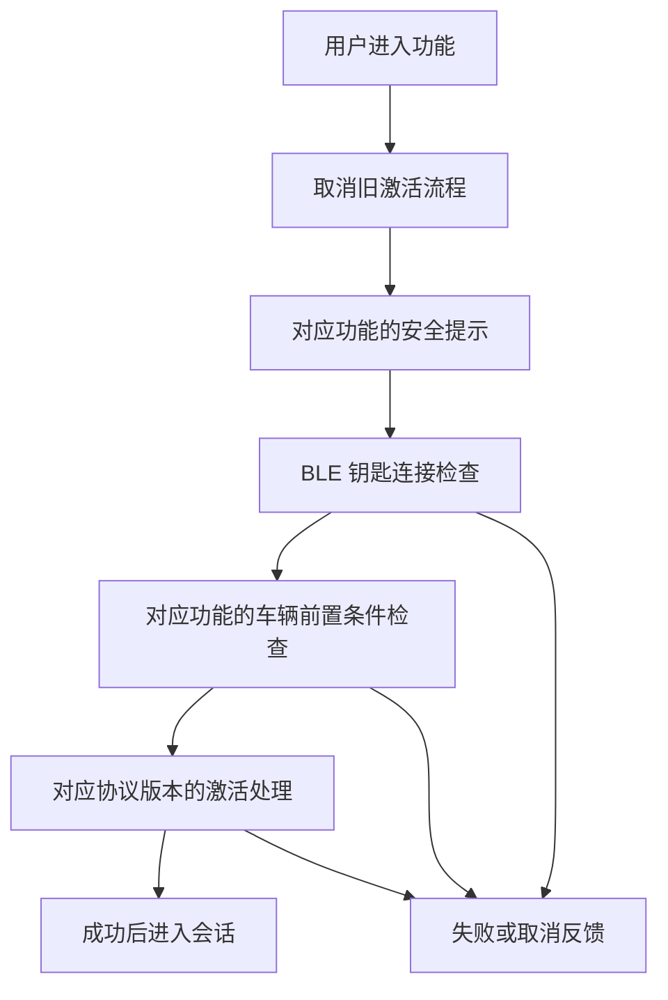

# RPS：激活流程、会话状态、障碍物显示与中断处理

分析日期：2026-11-25。范围是原版 Android 恢复代码的应用层行为；不是可发送的 BLE 协议实现，也未做实车验证。样本身份、哈希与反编译局限见 [复核记录](android-ble-uwb-followup-2026-11-25.md)。

## 1. 证据定位与阅读方式

源码根目录：`/private/tmp/nio-analysis-radio-src/sources/com/nio/rb/rps/`。本文路径均相对此目录，行号对应本次 JADX 输出。输出包含热修复 `PatchProxy` 分支，本文描述的是默认方法体；运行时热修复是否覆盖这些方法未验证。若输出包含无法恢复的 switch/协程，不据此断言运行时没有某项保护。

| 证据 | 路径与位置 | 可以回答的问题 |
| --- | --- | --- |
| R1 | `viewmodel/RbRpsImmoViewModel.java:1340`，`createInterceptors` | 激活前检查顺序及功能分流 |
| R2 | 同文件 `:1157`、`:1360`、`:1380`、`:1400` | BLE 协议版本对应的实现分支 |
| R3 | `immo/RpsImmoChain.java:49`，`a()` | 检查链如何继续到下一项 |
| R4 | `viewmodel/BaseRpsSessionViewModel.java:316`、`:367`、`:379`、`:443` | 任务取消、暂停、服务停止与回调 |
| R5 | `viewmodel/RbRpsRpaInSessionViewModel.java:130` | 状态对象到 UI 模型的映射 |
| R6 | `bean/RpaLocationBean.java:108`、`:261`、`:321` | 构造参数、原字段名、危险区域判定 |
| R7 | `ui/widget/RbRpaInSurfaceView.java:2007`、`:2081`、`:2130` | 车位、车辆、障碍物画面 |
| R8 | `base/vm/RpsSessionDisconnectViewModel.java:75`、`:188`、`:237`、`:283` | 电话、生命周期、计时器、按键事件 |
| R9 | `ui/fragment/rpaIn/RbRpsRpaInSessionFragment.java:1090` | 泊入页面如何消费中断事件 |
| R10 | `ui/fragment/nbs/RbRpsNbsBleSessionFragment$disconnectObserver$2.java:31` | NBS 页面如何消费同一中断事件 |

## 2. 不是“连接后直接进入移动”：激活检查链

`RbRpsImmoViewModel.activate()` 首先取消已有激活任务，再按功能创建拦截器列表。可见的功能族为 RPA 泊入、NBS、RPA 泊出。未知功能对应空列表，UI 提示 unknown function，不继续创建正常激活链。

三个功能族使用相同的流程骨架，但各自的安全提示、前置条件检查不同：

`RpsImmoChain.a()` 增加索引并取下一拦截器，然后调用其处理入口。这是应用流程编排，不能解释为认证消息的顺序或底层握手格式。

`RbRpsImmoViewModel` 根据车辆系统服务返回的 `Protocol.Ble.BLE_3_0`，在普通版与 `Nt3` 前置检查/激活实现之间选择。因此不能仅靠车型名称决定协议；也不能把一条车型上的成功路径推广到所有车辆。

输出通道分别包括 processing、hint、fail、state、success 和 wakeup hint。设计 iOS 状态模型时，应保持“正在检查”“需要用户处理”“检查失败”“已激活”的区别，避免用一个 loading 或 connected 布尔值替代。

## 3. 会话对象与任务生命周期

`BaseRpsSessionViewModel` 保持当前车辆、RPS service、方向 LiveData、会话状态和移动任务。可见行为包括：

- 启动新的移动任务前取消旧任务，减少同时存在多个 UI 驱动循环的可能。
- 暂停入口先取消移动任务，再启动独立暂停处理协程。
- `onCleared()` 调用 `stopRpsService()`；后者委托下层 service 停止。这个委托本身不证明停止请求已到达车辆。
- service 成功回调提取响应中的 `RpsSessionData`，交给 `onRpsMessage`；基类该方法为空，由功能子类解释。
- service 失败回调不是简单丢弃，而是生成本地失败状态对象，再送入同一状态处理入口。

最后一点影响日志判读：UI 收到的失败状态不一定是车辆实际上传的状态。文档、诊断和未来 iOS 模型应区分“车辆报告”“本地通信失败合成”“未知/过期”，不要把三者都作为真实车辆遥测落库。

## 4. 已恢复的 UI 数据映射

这次不是仅从类名猜测。用 R5 的构造参数顺序与 R6 的构造器赋值、`toString()` 字段名交叉核对，可建立以下映射。它是**已解析对象 → UI 对象**，不包含无线字节偏移、缩放或认证信息。

| RpsSessionData 字段 | RpaLocationBean 字段 | 恢复的原名称 / 用途 |
| --- | --- | --- |
| G | a | rpsSlotUIVehX：车位 UI 中车辆 X |
| H | b | rpsSlotUIVehY：车位 UI 中车辆 Y |
| I | c | rpsSlotUIVehPsi：车辆姿态参数 |
| v | d | rpsSlotUISizeX：车位 UI 尺寸 X |
| w | e | rpsSlotUISizeY：车位 UI 尺寸 Y |
| c | f | rpsSlotSts：车位状态 |
| D | g | sapaDrivingDir |
| F | h | sapaStopDstDisp：停止距离显示参数 |
| f | i | rpsFrntLeRegnDst：前左区域 |
| g | j | rpsFrntLeMidRegnDst：前左中区域 |
| h | k | rpsFrntMidRegnDst：前中区域 |
| i | l | rpsFrntRiMidRegnDst：前右中区域 |
| j | m | rpsFrntRiRegnDst：前右区域 |
| k | n | rpsReLeRegnDst：后左区域 |
| l | o | rpsReLeMidRegnDst：后左中区域 |
| m | p | rpsReMidRegnDst：后中区域 |
| n | q | rpsReRiMidRegnDst：后右中区域 |
| o | r | rpsReRiRegnDst：后右区域 |
| p | s | rpsLeFrntRegnDst：左前区域 |
| q | t | rpsLeMidRegnDst：左中区域 |
| r | u | rpsLeRearRegnDst：左后区域 |
| s | v | rpsRiFrntRegnDst：右前区域 |
| t | w | rpsRiMidRegnDst：右中区域 |
| u | x | rpsRiRearRegnDst：右后区域 |
| J | y | frntWhlAgDisp：前轮角度显示参数 |
| D | z | direction：同一原字段也供绘图方向使用 |
| 经 RpsActionState 转换 | A | rpsState：应用层状态分类 |

这些名称不能独立证明米、厘米、度、弧度或坐标原点。尤其名字含 `Dst` 的障碍物字段，在 UI 中存在离散级别判定，不应直接作为物理距离显示。

`RpsActionState` 的应用层名称包括 INIT、OFF、STARTING、MOVING、PAUSE、ABORT、SWITCHING、PARTIALLY_COMPLETED、UNKNOW。这些是 UI 分类，不是可直接发送的命令码，也不等于车辆原始状态值。

## 5. 障碍物不是 16 个独立红块：存在区域聚合

`RpaLocationBean.b(value)` 在值非空且等于 3 时返回 true；其他值与 null 返回 false。再通过 c/d/e/f/g/h/i/j 聚合到绘图区域：

| 绘图区域 | 被聚合的原字段 |
| --- | --- |
| 前中 | 前左中、前中、前右中 |
| 前左角 | 前左、左前 |
| 前右角 | 前右、右前 |
| 后中 | 后左中、后中、后右中 |
| 后左角 | 后左、左后 |
| 后右角 | 后右、右后 |
| 左侧中间 | 左中 |
| 右侧中间 | 右中 |

`RbRpaInSurfaceView.drawDangerBlockAge()` 消费这些聚合结果绘制对应方向的危险提示；`RbRpsRpaInSessionViewModel` 在存在上述危险区域且当前处于泊入方向时触发振动反馈。这里的 3 只能称为这个 UI 分支的危险判定值，不是“3 米”。

此外，`lastHeartbeatTimestamp` 实际控制该振动调用的节流。它既不是车端安全心跳字段，也不能用来推断断线后的停车延迟。

### 车位与轨迹画面

`createSlot()` 根据车位状态选择左/右垂直车位、左/右平行车位的 drawable 与矩形布局；某些状态会清除车位图。

`drawCar()` 将画布移到中心，按车辆样式比例缩放；符合绘制条件时依据 direction 调用预测轨迹绘制。**画面上的预测轨迹不能据此认定为车端实际规划路径**，更不能推断 UWB 的距离/方位直接生成了轨迹。需要进一步追踪绘图输入与几何算法，才能判断其来源。

## 6. 中断事件产生与消费必须分开看

`RpsSessionDisconnectViewModel` 的职责是发出事件：

| 输入 | 本类可见行为 | 不能直接推出 |
| --- | --- | --- |
| 生命周期 onPause | post `STATE_ON_PAUSE` | 车辆已经停止 |
| 电话状态为响铃/通话 | post `STATE_RECEIVER_PHONE` | iOS 有完全相同回调能力 |
| 音量增/减键 | post 对应事件；方法返回 false | 按键已被系统消费或一定发出无线请求 |
| resetDelay | 移除旧 Runnable，重新安排 30 秒计时 | 30 秒是车端通信失联门槛 |
| Runnable 到期 | post `STATE_TIME_OUT` | 每个页面都执行相同动作 |
| ViewModel 清理 | 移除 Handler 回调并注销电话监听 | 车辆侧会话必然同步销毁 |

类中虽然声明 `INIT_DISCONNECT_TIME = 100000`，在本次恢复的方法体中没有找到它被传入计时器的路径；不能据字段存在就写成“启动时必定有 100 秒计时”。

电话监听按 Android API 级别选择 TelephonyCallback 或旧 PhoneStateListener。创建/销毁还涉及请求/释放音频焦点；这是移动端生命周期策略，不是 BLE 协议。

### 消费者差异

泊入页面的可见 observer 对来电、音量键、onPause 调用 `pause()`；timeout 分支显示为直接返回。NBS observer 的 timeout 分支调用失败处理，其他中断事件转入暂停。

部分 observer 标注了字符串 switch 恢复失败。对泊入 observer 又进行了限定类、关闭匿名类/方法/Kotlin lambda 内联的 simple 模式复核，输出 `/private/tmp/nio-rpain-disconnect-simple.java:45`：timeout 分支跳到 `L22`，比较字符串后直接返回；onPause/音量键/电话分支跳到 `L21` 调用 pause。这与第一份输出一致，增强了“本地 observer 对这些事件处理不同”的证据。

这个结论仍不能用于证明真实 App 对 timeout 缺少保护：其他层可能处理计时、服务异常或车辆侧失联，热修复行为也未验证。需要继续区分 UI 无操作计时与无线失联保护。

## 7. 与 UWB 的关系：当前能证实什么

本次检查的 RPS UI/拦截器树没有建立一条“UWB SDK 距离回调 → RPS 允许移动”的完整链路。另一方面，已找到的 UWB 钥匙管理路径属于 OEM 数字钥匙服务。两者同时存在不等于泊车由 UWB 控制。

因此，目前可以分别描述 BLE 会话控制、车端状态到 UI 的转换、OEM UWB 钥匙管理；尚不能合并成已验证的 UWB 离车泊入实现。

## 8. 对 iOS 实现的具体影响

以下是设计建议，不是原版已有 Swift 实现：

- `VehicleCapability`：按车辆协议能力选择实现，不按车型显示名硬编码。
- `ActivationState`：区分安全提示、连接检查、车辆条件检查、激活、失败与取消。
- `SessionSnapshot`：保存车辆身份、接收时间、来源（真实/本地失败）、UI 状态与可空显示数据。
- `ObstaclePresentation`：先映射区域级别，再聚合 UI；未知值保留为未知，不能等同安全。
- `SessionInterruption`：生命周期、电话/系统中断、用户松手、连接断开与通信过期分别建模。
- transport 只接受当前合法会话的操作；界面任务取消、下层请求取消、车辆确认须分别记录。

可以先在模拟 transport 下验证：切换车辆后丢弃旧回调、重复激活不会生成并行会话、暂停后旧任务不更新 UI、null 障碍物不显示为安全、通信失败不会冒充实车状态、后台后恢复不会自动继续旧操作。

仍需补齐的协议证据包括底层 transport 契约、合法认证、实际帧解析与单位、车辆侧失联行为；本轮没有将反编译中的局部逻辑接到实车。
