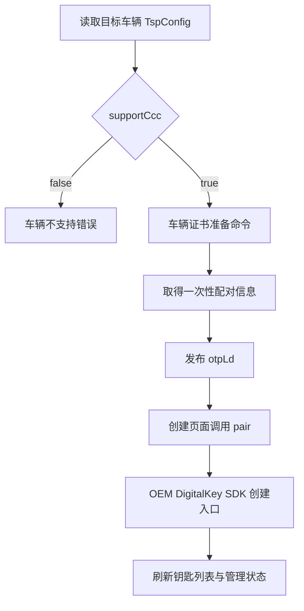

# Android UWB 数字钥匙：创建、系统服务与距离设置的详细分析

更新：2026-11-25。接续 [方法体复核](android-ble-uwb-followup-2026-11-25.md)。本篇只分析已有离线样本，没有请求云端接口、读取现存钥匙材料、操作车辆或重新附加 Frida。

## 1. 先分清这里的四条链路

原版不是一个 `UwbManager` 包办所有功能。当前恢复代码呈现四条相互关联、职责不同的链路：

| 链路 | 主要入口 | 已观察到的结果 |
| --- | --- | --- |
| 手机能力与钥匙存在性 | `RbUwbManager → SamsungUwbManager` | OEM 系统服务能力、系统钥匙列表、指定 keyId 是否存在 |
| 创建合法数字钥匙 | `RbKeyUwbCreateFragment → RbKeySamsungUwbViewModel` | 车辆能力检查、证书相关准备、一次性配对信息、调用 OEM SDK |
| 近车解锁设置 | `RbBleKeyUwbManagerFragment → RbUwbManagerViewModel` | 云端车辆状态展示与距离档位设置 |
| 外部返回/转接 | `RbKeyUwbTransferActivity` | 登录与设备能力检查、发布钥匙管理事件、回到车辆页 |

这些代码尚未给出 UWB 空口测距会话、距离/角度采样或 UWB 数据驱动泊车的实现。**创建 UWB 数字钥匙、设置近车解锁距离、UWB 离车泊入，不是同一项能力。**

## 2. 证据等级及可复核位置

以下路径均相对于 `/private/tmp/nio-analysis-radio-src/sources`。行号针对本次 JADX 输出，重新反编译可能变化。DEX 身份及哈希见方法体复核文档；本次反编译报告过错误，因此不把缺失或空方法体解释成真实运行行为。

| 编号 | 文件与方法 | 位置 | 证据用途 |
| --- | --- | --- | --- |
| U1 | `com/nio/rb/virtual/key/utils/ccc/RbUwbManager.java` 懒加载工厂 | 24–40 | OEM 分派 |
| U2 | 同目录 `RbUwbManagerTool.java` | 14–51 | 纯委托层 |
| U3 | 同目录 `impl/SamsungUwbManager.java` | 34–208 | 服务初始化、支持检测、钥匙查询、创建入口 |
| U4 | `com/nio/rb/key/manager/viewModel/RbKeySamsungUwbViewModel.java` | 193–203、204–321、334–483、485–588、770–907 | 生命周期、配对、错误管线、证书准备、车辆能力检查 |
| U5 | `com/nio/rb/key/manager/ui/fragment/RbKeyUwbCreateFragment.java` | 108、208–257 | 创建动作与 OTP LiveData 到配对的串接 |
| U6 | `com/nio/rb/key/manager/api/RbUwbApi.java` | 18–26 | 证书准备与一次性配对信息接口声明 |
| U7 | `com/nio/rb/key/manager/viewModel/RbUwbManagerViewModel.java` | 61–176、272–358 | 距离写入、状态读取、取消订阅 |
| U8 | `com/nio/rb/key/manager/ui/fragment/RbBleKeyUwbManagerFragment.java` | 115–253、474–510 | 加载/失败/成功 UI 与状态映射 |
| U9 | `com/nio/rb/key/manager/ui/widget/UwbManagerDistanceSettingHolder.java` | 60–121 | 近/远档位对应值 |
| U10 | `com/nio/rb/key/manager/api/RbAppApi.java` | 30–33 | 距离设置 HTTP 声明 |
| U11 | `com/nio/rb/key/manager/ui/activity/RbKeyUwbTransferActivity.java` | 93–203 | 转接前置检查与事件通知 |

“静态已确认”指这些方法体和类型关系可见；并不表示当前服务仍接受该接口、车机实际执行或热修复后完全相同。

## 3. OEM 系统服务边界

### 3.1 工厂不是测距实现

U1 根据 `PlatformSource.a.g()` 选择 `SamsungUwbManager` 或 `DefaultUwbManager`，再包装为 `RbUwbManagerTool`。U2 的四个方法直接委托，没有自己的 BLE 连接、测距、加密或缓存算法。

接口覆盖：支持检测、是否存在 UWB/BLE 钥匙、指定 keyId 可用性、创建数字钥匙。可见 API 返回的是 `Observable<Boolean>`，不是 `Observable<距离/角度>`。

### 3.2 初始化与缓存

U3 的 `d()`（反编译注释标记 `initSdk`）先检查实例内缓存的 `DigitalKeyManager`：

1. 已有 manager：直接返回 `Observable.just(manager)`。
2. 没有 manager：建立 `PublishSubject`，调用 `DigitalKeyManager` 的异步请求服务入口，传 application context 与 callback。
3. 成功 callback：缓存 manager，`onNext(manager)`，随后 `onComplete()`。
4. 失败 callback：记录错误，并对 subject `onError(exception)`。

源码在该方法内未显示“初始化中的共享请求”字段。因此只能确认缓存完成后的复用，不能声称多个同时到达的首次调用一定合并。未看到服务断连后缓存失效的实现；此边界留待 SDK 层分析。

### 3.3 支持检测与钥匙存在性不能混淆

- `isSupport()`：在取得 SDK manager 后检查系统 feature `samsung.hardware.uwb`。
- `hasUwbBleKey`：SDK 钥匙列表不为空即返回 true，没有在该局部方法里按车辆筛选。
- `checkKeyAvailable(keyId)`：遍历 SDK 列表，将 `DigitalKeyDataListItem.getDigitalKeyId()` 与传入 keyId 比较。

由此可得三个不同状态：手机具有硬件/服务能力、系统中存在某把钥匙、目标钥匙存在。上层不可用一个 `supportsUWB` Boolean 替代三者，更不能把“列表非空”当作当前车辆授权完成。

`DefaultUwbManager` 的支持检测返回 false，部分其他方法返回空 Observable。这只是该分派路径的默认实现，不足以推断所有非三星 NIO 功能。

## 4. 创建流程：App 编排，OEM SDK 承接钥匙创建

### 4.1 车辆与证书前置步骤

U4 的 `checkAndDownloadCert` 以当前账号相关标识选择 `RbCertSafeStorage`，检查存储可用状态；日志将其称为 `tlsCertExist`。已存在则调用后续 callback，否则调用 `VehicleCertificateService2` 准备证书并通过回调处理结果。

该证据说明此流程依赖账号证书服务；**不能据此断言这是 BLE 会话证书，也不能断言它与项目里保存的任意 mTLS 文件可互换。** 证书用途、绑定关系与存储策略仍需在证书服务层单独验证。

`startOp(activity, vehicleId)` 的可见串接为：

这里的 OTP 是数字钥匙配对流程的一次性信息，不是此前账号登录短信验证码。

U6 声明两个上游职责：为指定车辆配置 CCC 证书、取得与车辆及账号散列标识关联的一次性配对信息。返回类型均为 `BaseModel<CmdResBean>`；U4 将它们封装为 `RemoteCmd`，通过 `HttpLoopCmdInvoker` 运行。因此不能把单次 HTTP 返回当作车辆侧准备已完成；具体完成判据属于命令框架，目前未在本篇恢复。

### 4.2 错误处理并非简单重试

U4 的 `handleCertCmdError` 与 `handleOtpCmdError` 依次组合 PIN、命令和网络错误处理管线。PIN 管线的回调可重新执行对应命令；其他错误向原 subject 传播。这里只能确认存在用户验证/命令错误分流，不能把它转换成无条件重试，更不能跳过 PIN。

`startOp` 的终端失败进入 `CmdPipelineGroup`、`NetworkPipelineGroup` 显示消息。成功分支发布内存字段 `otp` 到 LiveData。部分日志语句拼接 OTP；如果未来移植到本项目，应保留状态和错误码，不能沿用记录敏感配对信息的日志方式。

### 4.3 与现有 BLE 钥匙的互斥协调

这是本轮新增的重要方法体证据。U4 的 `pair()` 不只调用系统 SDK：

1. 订阅创建流程时读取 `BleKeyManager.k(vehicleId)`。
2. 若状态为 `BleKeyStatus.ACTIVATED`，调用 manager 的开关入口传 false，并记录 `isCloseBleKey = true`。
3. 调用 `RbUwbManager` 的创建入口，将一次性配对信息交给 OEM SDK。
4. SDK Observable 有结果后查询该车辆钥匙列表；终端成功调用 `CccUtils` 更新/处理钥匙管理状态。
5. `doFinally` 检查是否由本次流程关闭了 BLE 钥匙；若是则传 true 恢复，最后结束 Activity。

这说明原版在配对期间协调已有 BLE 钥匙状态，不能把 UWB 创建当成与 BLE 完全无关的后台请求。`doFinally` 包括完成、错误或取消的清理路径，页面关闭不能单独作为配对成功证据。

当前恢复的 Samsung 创建 callback 类体不完整，无法确认它如何把 SDK 成功/失败转换为 Boolean；`pair()` 的后续 flatMap 也未检查 Boolean 值。因此只能确认“存在结果后继续查列表”的静态结构，不能推断所有取消行为或失败码。钥匙列表查询之后的精确授权绑定结果仍需补证。

#### 创建 callback 的第二种反编译与 DEX 结构复核

为判断缺口是 JADX 控制流还原失败还是样本本身缺少方法，本轮又对 `SamsungUwbManager$createDigitalKeyImpl$1` 使用 `--single-class`、`--no-inline-anonymous`、`--decompilation-mode simple`，输出 `/private/tmp/nio-uwb-create-callback-simple.java`。该限定任务退出码为 0，输出仍只有 `PublishSubject<Boolean>` 字段与构造器，没有成功/错误 callback override。

进一步直接解析原 DEX 的 `class_def → class_data_item → encoded_method`，结果为：

| DEX 类数据项 | 数量/结果 |
| --- | --- |
| static_fields | 1 |
| instance_fields | 1 |
| direct_methods | 1，仅 `<init>`，code_off=2386300 |
| virtual_methods | 0 |
| superclass | `org.carconnectivity.android.digitalkey.framework.sdk.DigitalKeyCallback` |

在既有 `/private/tmp/nio-scudo.bin` 中，对含目标类描述符的标准 DEX 候选检查 class definitions，仅在偏移 265183232、长度 2569676 的已知 DEX 中找到此类定义。这个有界检查没有找到另一个完整版本。

结论：**此处至少存在样本方法定义缺口，不能靠再换一次 Java 输出模式补回 override 实现。** 这也不能反向证明原版运行时从不回调；父类行为、运行时修补、其他未取得代码仍未验证。后续需要不同来源的完整类定义或合法运行时结果证据，而不是对空类体补猜“成功即 true、失败即 onError”。

### 4.4 生命周期

U4 保存 `CompositeDisposable`，`onCleared()` 中 dispose。U5 使用 `getViewLifecycleOwner()` 订阅 OTP LiveData，而不是把观察者绑定到无限生命周期。可见设计意图是随页面和 ViewModel 释放工作；底层 SDK 的取消是否能中止系统钱包页面或硬件配对，本层没有证据。

### 4.5 OTP 与选车身份的局部绑定检查

本轮只检查当前恢复的创建 Fragment 与 ViewModel，发现两次取车辆 ID 的时点不同：

1. `RbKeyUwbCreateFragment.createUwb()`：75–108 行先读取当前 `selectVehicle.id`，捕获到证书准备 callback，随后以该捕获 ID 调用 `startOp(activity, id)`。因此发起准备/OTP 的目标 ID 在这个 callback 中固定。
2. `otpLd` 类型只有 `MutableLiveData<String>`；208–225 行观察者把收到的字符串传给 Fragment 的 `pair(str)`。
3. `pair(String)`：245–257 行再次读取当时的 `selectVehicle.id`；OTP、选车、车辆 ID 或 Activity 缺失时直接返回，否则调用 ViewModel 配对。
4. `chooseVehicle()`：385–392 行直接更新 `selectVehicle` 并刷新 adapter，该局部方法未显示进行中状态检查。adapter 注册了选车处理器。
5. ViewModel 的 `startOp` 与 `pair` 都使用 `RxLoadingTransformerKt`；当前这组恢复目录没有该组件实现，无法验证 loading 是否阻止换车、是否可取消及外部状态如何影响选车。

所以目前只能报告：请求阶段捕获原车辆 ID，OTP 回调阶段读取当前选车；没有在该局部 LiveData 中携带车辆 ID。**尚不能据此判定实际可发生串车，也没有运行时复现。** 新版若实现同类流程，可用 `{vehicleId, operationId, result}` 绑定请求与结果，并在取消或切车后明确丢弃旧结果，避免依赖 loading 控件的隐含行为。

## 5. “UWB 距离设置”实际是近车解锁档位

### 5.1 展示数据来自车辆状态

U7 的 `fetchVehicleStatus(vid)` 请求 `KEY_STATUS` 与 `DOOR` 两组状态，转换为 `SummarizedStatus` 后发布 LiveData。U8 `refreshList` 使用：

| 展示项 | 数据来源 | 空/缺失处理 |
| --- | --- | --- |
| 近车自动解锁状态 | `SummarizedStatus.isApproachUnlock()` | 局部分支默认 false |
| 距离档位 | `DoorStatus.getPepsEntryDistance()` | 缺失时 -1 |

这不是 App 读取本机 UWB 实时测距值。页面名称有 UWB，并不意味着页面直接拥有距离采样。

### 5.2 近/远是枚举，不是米数

U9 的 `btnNear` 对应值 1、`btnFar` 对应值 3；选中态也按这两个值比较。未见值 2 的按钮。**不能把 1/3 解释为 1 米/3 米。** -1 不应渲染成任何已知档位。

U10 为 form-urlencoded POST，路径为 `/api/1/vehicle/{vehicle_id}/command/set_ble_unlock_distance`，表单字段 `distance`。方法名叫 `setUwbUnlockDistance`，路径却写 `set_ble_unlock_distance`；这是实际静态契约上的命名差异，应保留，不要擅自改成猜测的 UWB 路径。

U7 使用 `NetKit` 的网络服务发送请求，成功后发布 `RbLdResult.Success(distance)`；U8 收到成功仅更新本地模型档位并刷新列表。**这个局部成功路径没有立即重新读取车辆状态**，所以“按钮变成新档位”不等于已核验车辆实际应用该设置。

### 5.3 加载与错误

状态读取有 Loading、Success、Error 三种 UI 分支；失败通过网络错误管线展示可重试空态。设置失败进入错误消息管线；成功改变本地档位。`RbUwbManagerViewModel.onCleared()` 释放订阅。未来移植应区分读取失败、写入失败、上游接受但尚未回读确认，不能统一显示“UWB 不支持”。

## 6. 外部转接不等于原始钥匙迁移协议

U11 `RbKeyUwbTransferActivity.checkPrecondition()` 检查登录，然后检查 OEM UWB 支持。支持时发布 `RbKmEventChannel.KmEvent`，并通过 deep link 回到车辆页；错误时处理消息并返回车辆页。

当前方法体证实的是页面协调与状态刷新事件，没有显示导出私钥、复制钥匙材料或跨设备迁移的空口协议。不能因为类名含 Transfer 就推断存在可自行复刻的钥匙搬迁接口。

## 7. 与 RPS / 离车泊入的关系：能证实什么

已证实：UWB 配对会暂时协调已有 BLE 钥匙；UWB 管理读取近车解锁相关车辆状态。未证实：RPS 直接订阅这个 manager 的 UWB 测距或用其作用户距离判断。

本轮在已恢复的 `com/nio/rb/rps/**/*.java` 搜索 `RbUwbManager`、`SamsungUwb`、`uwb`、`Uwb`、`nearTheVehicle`，排除 Metadata 行后没有命中。这是**该部分恢复树中的有限负结果**，不能证明整个 App 或车辆端没有融合 UWB。可能存在未恢复模块、OEM/车辆端处理或不同命名，需要沿实际 RPS 条件字段来源继续追踪。

因此 iOS 应拆分三个接口契约：钥匙可用性、近车设置、泊车会话资格。不要用“UWB 硬件支持”直接开启泊车按钮，也不要用云端近车设置档位代替实时距离约束。

## 8. 当前可以形成的实现规格与待补证清单

| 问题 | 当前状态 | 下一份需要的证据 |
| --- | --- | --- |
| OEM 分派与系统服务请求 | 方法体已确认 | 服务断连与初始化并发行为 |
| 设备支持与目标钥匙存在 | 方法体已确认 | 目标车辆/keyId 绑定与失效策略 |
| CCC 创建业务阶段 | 主要编排已确认 | RemoteCmd 完成判据、SDK 创建 callback |
| BLE 配对期关闭/恢复 | 方法体已确认 | 取消/崩溃后的运行时恢复行为 |
| 近/远档位读写 | 静态接口及 UI 值已确认 | 车型支持、服务端响应、车辆状态回读 |
| UWB 距离/角度数据 | 未找到直接数据通道 | 实际测距 provider、类型与消费者 |
| UWB 驱动离车泊入 | 未建立调用证据 | RPS 资格字段的数据来源与车辆侧行为 |
| iOS 数字钥匙接入 | 本样本不能证明 | 对应平台及车辆的正式接口与权限 |

当前可据此设计模拟状态机和用户界面，但不能宣称已获得可运行的 iOS UWB 钥匙或泊车实现。本篇没有新增功能代码或实车验证结果。
