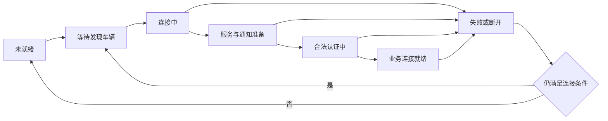

# iOS BLE / UWB 移植：功能与逻辑规格

日期：2026-11-25。本文只定义需要实现的行为，不规定 Swift 写法、类名或文件结构。参考 [BLE 分析](android-ble-lifecycle-detailed-analysis.md)、[UWB 分析](android-uwb-detailed-analysis.md)、[RPS 分析](android-rps-state-detailed-analysis.md)。

标记说明：**已知**为原版静态证据；**目标**为本项目拟实现的行为；**待确认**为仍缺协议或平台证据。本文不是功能已完成报告。

实际 GATT UUID、外层包格式、通知重组与版本分派见 [BLE 线协议证据](ble-wire-protocol-evidence.md)。本文的业务规格不能替代该协议层。

## 1. 功能边界与前置依赖

需要分别实现五项能力：钥匙管理、BLE 连接与合法认证、近车设置、UWB 测距（若车辆开放兼容接入）、泊车会话。它们不能用一个“数字钥匙已开启”状态代替。

| 能力 | 功能目标 | 真实接入前置条件 |
| --- | --- | --- |
| 数字钥匙管理 | 创建、启用、停用、查询、删除和失效处理 | 目标车辆支持；账号有权限；合法证书与配对流程可用 |
| BLE 通信 | 发现车辆、连接、认证、接收状态、断开恢复 | GATT 契约、合法认证及消息契约完整 |
| 近车设置 | 查看自动解锁状态，设置支持的距离档位 | 车型支持、上游授权及状态回读可用 |
| UWB 测距 | 获取目标车辆相对距离/方向及有效性 | 实际测距通道与该车型的 iOS 兼容性已确认 |
| 泊车 | 前置检查、进入会话、用户持续操作、暂停、结束及异常处置 | 合法控制接口、状态语义、车辆端安全机制已验证 |

原版 Android OEM 数字钥匙接口不能直接等同于 iOS 能力。Apple 的 CarKey 框架要求专门 entitlement，申请者须为参加 MFi 的车厂；这不表示所有 BLE 接入都需要同一授权。[Apple CarKey](https://developer.apple.com/documentation/carkey)

Nearby Interaction 的第三方配件路径需要兼容的配件协议与配置数据；“车辆有 UWB”或“钥匙已在钱包里”均不足以证明本 App 能获取测距结果。[Apple Nearby Interaction](https://developer.apple.com/nearby-interaction/)、[配件配置](https://developer.apple.com/documentation/nearbyinteraction/ninearbyaccessoryconfiguration)

## 2. 账号、车辆与操作上下文

**目标：每个任务都绑定发起时的账号、车辆和本次会话，不在异步返回时重新猜当前目标。**

需要保存的逻辑信息：当前账号/租户、车辆 ID、钥匙标识、能力版本、任务标识、创建时间、状态及结果来源。不得用 API Key 原文充当显示或日志中的账号标识。

处理规则：

1. 开始任务时固定目标账号和车辆。
2. 返回结果时核对任务仍有效、账号和车辆仍匹配。
3. 切车/切账号使旧连接、配对、确认弹窗及操作资格失效；旧回调不能更新新车界面。
4. 不将旧车的认证完成状态继承给新车。
5. 登出后清除会话与本地访问资格；本地清理不等同服务端撤销钥匙。

**验收：** A 车的认证、状态或配对结果在切到 B 后返回，不能让 B 显示已连接或配对成功。

## 3. 能力与权限检查

**输入：** 手机系统能力、权限、车辆协议/配置、账号车辆关系、钥匙记录。

**输出：** 每项功能的可用性和具体不可用原因。至少区分：手机不支持、车辆不支持、权限未授予、钥匙未创建、钥匙已停用、账号无权、连接未完成、上游暂不可用、信息未知。

规则：先判断设备/车辆是否支持，再检查授权和运行条件；未知不能默认可用。功能能力应按车辆配置判断，不能仅按 ET5/ET5T 等显示名称推断。

授权不足时提供对应操作入口；接口错误应显示失败与重试，不能误显示为“不支持”。用户拒绝权限后不要通过循环弹窗继续请求。

## 4. 钥匙生命周期

需要区分的状态：未创建、准备中、等待用户验证、配对中、已创建但停用、已启用、失效、删除中、结果未知。

### 创建与配对

1. 固定账号和目标车辆，检查车辆能力及创建资格。
2. 检查合法证书/授权材料是否就绪；缺失时返回明确原因，而非永久停留在加载中。
3. 完成要求的用户身份验证；取得仅用于本次任务的配对信息。
4. 调用对应平台的合法配对流程。
5. 查询目标车辆对应钥匙，核对绑定关系，确认后才显示创建成功。
6. 清理一次性信息和临时任务状态。

**已知：** Android UWB 创建包含车辆 CCC 能力检查、证书相关准备、一次性配对信息、OEM SDK、钥匙列表刷新。它的 OTP 不是登录短信验证码。

**目标：** 一次性信息与发起车辆一起传递。配对期间换车，应取消或阻止当前任务继续；不能取得 A 的配对信息后对 B 执行后续步骤。

### 与已有 BLE 钥匙的协调

**已知：** Android 配对时可能临时关闭已激活的 BLE 钥匙，结束后恢复。

**目标：** 如 iOS 接入方案也要求临时停用，应记录“由本任务改变了什么”。结束时重新检查账号、车辆、钥匙和用户意图，只恢复本任务临时改变的状态；不能覆盖用户在期间主动停用的选择。异常退出后通过状态核对恢复，不仅依赖正常完成回调。

### 停用、删除与撤销

这三项应分别展示结果：本机停止使用、删除本机记录、服务端/车辆端授权撤销。若撤销请求超时，状态为未知并安排查询，不能直接显示“已彻底删除”。敏感材料不进入普通日志、分析报告或跨设备同步缓存。

## 5. BLE 连接与认证

逻辑阶段：

**目标规则：**

- 只有当前车辆、钥匙启用、权限满足且当前策略允许时才能发起连接。
- 可缓存多车记录，但第一阶段只管理一个活动车辆连接，避免跨车混用。
- 连接成功、通知就绪、认证完成分别展示；认证前不开放受保护业务能力。
- 连接事件携带所属任务，重复或过期事件不得把状态退回旧阶段。
- 断开后立即使认证资格和旧业务请求失效，对等待中的操作返回明确失败/未知。
- 重连采用有上限的退避；蓝牙关闭、钥匙停用、登出、切车或用户停止时，不继续无条件重连。
- 恢复连接只恢复通信能力，不自动恢复先前泊车操作。

缓存设备标识只能帮助发现目标，不能代替身份认证。Android 的 MAC、bonded 状态及本地 bound 标记也不能直接作为 iOS 身份模型。

**待确认：** 实际服务/特征契约、消息边界、应答关联、认证契约、错误分类、重试语义。缺失时可验证状态机，不能猜报文接入实车。

## 6. 消息、状态与结果可信度

每条状态需要携带目标车辆、所属会话、收到时间、来源与完整性。区分车辆上报、云端查询、本地失败合成和历史缓存。

接收逻辑：身份与会话核对 → 消息合法性检查 → 转换为业务状态 → 标记时间和来源 → 更新对应功能。不能收到任何通知都刷新整车“在线时间”。

需要处理：重复响应、晚到响应、断开后响应、无法解析、未知枚举、字段缺失和超过有效期。未知状态不应被补成“安全”“零距离”或“已经停止”。

UI 可以显示历史值，但必须区分实时/过期。已有 Android 解析对象到 UI 的字段映射可用于显示设计，不能直接当作已验证的无线格式或物理单位。

## 7. 近车自动解锁设置

**输入：** 当前车辆 KEY_STATUS/DOOR 等状态、车型支持的距离档位。

**展示：** 自动解锁是否开启、当前档位、是否正在读取/保存、状态是否已确认。

**修改逻辑：** 读取状态 → 用户选档 → 固定车辆提交 → 显示等待确认 → 回读车辆状态 → 与目标档位一致才显示已生效。超时或回读不一致时保留“待确认/未生效”，允许重新查询，避免盲目重复写入。

**已知：** Android UI 的近/远为离散档位，不是米数；设置接口名字仍含 BLE。界面应使用能力提供的档位含义，不把这些值解释成 UWB 距离。

## 8. UWB 测距（独立、可选功能）

**前置：** 已确认该车辆向本 App 开放兼容的测距能力，且目标身份和合法会话绑定完成。当前证据尚未满足此前置条件。

若具备接入条件，需要实现：建立测距会话、目标配置交换、接收距离/方向、处理质量与可用性、暂停/恢复/失效、清除旧目标结果。

每份测量应表达：目标身份、采样时间、距离是否可用、方向是否可用、来源与可信度。方向缺失不应导致距离也被伪造；最后一次有效值不能无限沿用。

测距恢复后需要重新确认目标。不得用 RSSI、设置档位、`nearTheVehicle=true` 或单纯 BLE 连接来伪装 UWB 实测结果。

**与泊车的关系：** 测距只是可能的输入，不能单独授权移动。只有确认原车控制契约如何使用接近资格后，才能接入泊车条件判断；当前不要定义一个自创距离阈值直接开放功能。

## 9. 泊车功能状态与交互

需要区分：不可用、准备检查、等待用户确认、激活中、已就绪、用户操作中、暂停中、已暂停、结束中、已完成、失败、连接丢失/结果未知。

### 进入会话

固定车辆和功能 → 提示必要操作条件 → 检查合法钥匙/认证连接 → 检查对应车辆条件 → 请求进入合法泊车会话 → 收到有效确认后显示就绪。

车辆条件必须来自已确认协议和对应功能，不能复制一组通用条件覆盖所有车型/泊入/泊出。功能不支持、条件不满足、通信失败需要分别反馈。

### 用户操作与中断

只在有效会话、当前状态允许且用户持续表达操作意图时继续对应操作。用户松手、界面失活、账号/车辆切换、连接失效或状态过期，都使当前操作意图失效。

中断时先停止产生新的操作，尝试通过合法接口请求暂停/结束，并等待可确认状态。链路已经丢失时应显示“无法确认车辆状态”，不能因为手机侧任务取消就显示“车辆已停止”。恢复 App 或连接后不自动继续操作。

具体命令周期、应答期限与车辆端失联行为必须依据经验证的契约，不使用此前观察到的振动节流时间或 UI 无操作计时替代。

### 状态与障碍物显示

分别处理车辆动作状态、车位状态、显示位置/姿态、前轮角度和障碍物区域。沿用已确认的区域聚合关系，但对单位和未知等级保留未知。

本地通信失败不能冒充车辆报告的失败；预测轨迹需要注明其数据来源，不能因 UI 画出轨迹就认定是车端规划。任务完成必须由有效的完成状态确认，不能由动画播放结束判定。

## 10. 前后台与系统恢复

将普通钥匙连接/近车功能与前台泊车会话分开管理。后台允许维持的通信任务，不代表允许后台继续用户交互型操作。

iOS 蓝牙后台处理和状态恢复有系统限制，不保证 App 永久运行或随时重新启动；恢复后必须重新核对账号、车辆、钥匙与会话有效性。[Apple 蓝牙后台处理](https://developer.apple.com/library/archive/documentation/NetworkingInternetWeb/Conceptual/CoreBluetooth_concepts/CoreBluetoothBackgroundProcessingForIOSApps/PerformingTasksWhileYourAppIsInTheBackground.html)、[恢复启动规则](https://developer.apple.com/documentation/technotes/tn3115-bluetooth-state-restoration-app-relaunch-rules)

需要覆盖：锁屏、进入后台、系统终止、用户强制退出、蓝牙开关、权限撤回、手机重启和账号退出。每种情况下都明确哪些任务可恢复、哪些必须由用户重新发起。不能把 Android 电话/音量键监听逐项等同为 iOS 能力。

## 11. App 与 Rust 后端的职责

| App 本机 | Rust 后端 |
| --- | --- |
| 用户意图、权限、连接与本机会话 | 多租户鉴权、账号车辆关系与能力查询 |
| 平台合法钥匙接入及本地材料使用 | 已确认的云端钥匙准备/状态查询流程 |
| 近车状态展示与用户修改 | 档位设置转发、查询结果与错误归一化 |
| 实时状态、过期判断、中断处理 | 脱敏审计、操作关联与云端任务状态 |

后端不冒充手机 BLE 链路，不承担本地无线实时保活。现有云端 token、HTTPS mTLS 和数字钥匙材料分开管理；不能因服务端持有 token 就认定它有本地钥匙权限。

## 12. 分阶段交付与验收

| 阶段 | 要实现什么 | 验收出口 |
| --- | --- | --- |
| 1：功能状态骨架 | 能力判断、账号车辆绑定、钥匙/连接/会话状态、错误分类 | 模拟数据覆盖成功、失败、取消、切车和晚到回调 |
| 2：只读真实能力 | 可用的车辆/钥匙状态查询、近车档位展示 | 与合法上游状态一致；失败不伪装成不支持 |
| 3：合法钥匙与 BLE | 平台配对、停用恢复、真实连接认证、状态通知 | 目标身份匹配；断开失效；不串账号/车辆 |
| 4：近车设置 | 档位写入、结果未知处理、回读确认 | UI 只在状态确认后显示生效 |
| 5：UWB | 仅在兼容性证据成立后实现真实测距 | 距离/方向可空、过期及换车处理正确 |
| 6：泊车 | 完整条件检查、合法会话、操作与中断逻辑 | 协议与车辆安全行为充分验证后进行受控验收 |

阶段 1 可以现在实现；阶段 2/4 取决于合法上游接口验证；阶段 3/5/6 仍有明确契约及平台依赖，不能用模拟成功替代真实完成。

关键验收用例：配对时换车；配对取消后恢复原钥匙状态；权限拒绝/撤回；连接成功但认证失败；旧会话通知晚到；断开时存在待处理请求；上游已接受但响应丢失；档位回读不一致；测距缺方向/过期；前后台切换；恢复连接不续接旧操作；本地删除但远端撤销未知。每项分别记录输入、状态变化、用户提示与最终可确认结果。

## 13. 仍须补齐的证据

1. iOS 对该车型可用的合法数字钥匙接入方式与资格。
2. BLE transport 与合法认证契约、消息语义和错误分类。
3. 钥匙创建/删除/撤销的服务端与车辆端完成判据。
4. 实际 UWB 测距 provider、目标绑定和 iOS 兼容性。
5. 泊车条件、状态单位、超时与车辆端失联保护的完整契约。

在这些证据补齐前，文档中的功能目标可以指导开发与模拟验收，但不能宣称已经完成可用的 iOS 数字钥匙或离车泊入。
